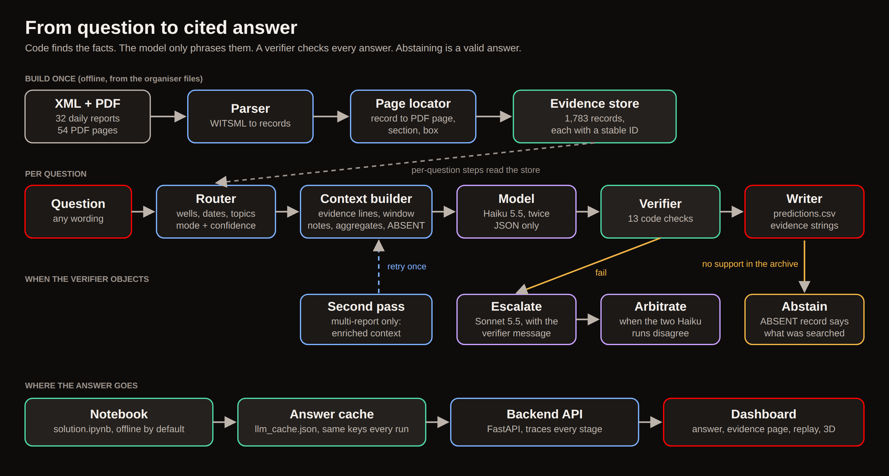
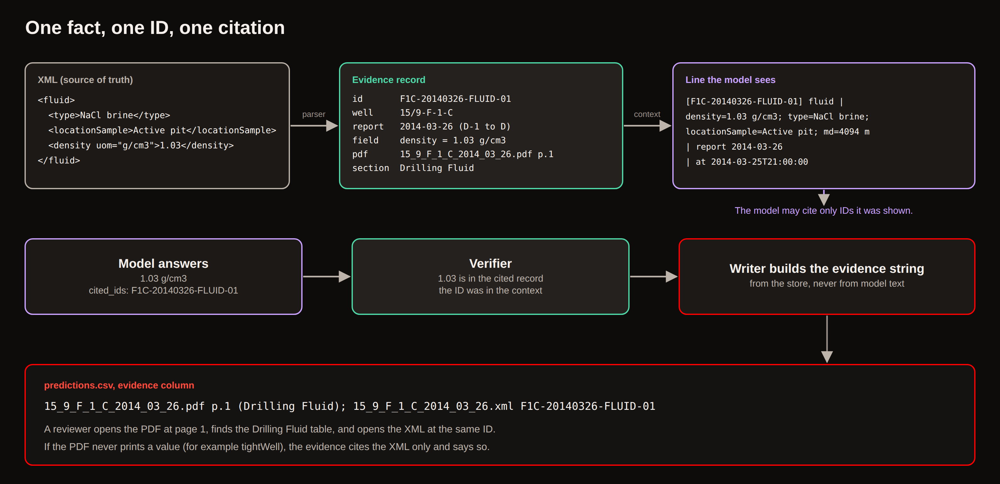
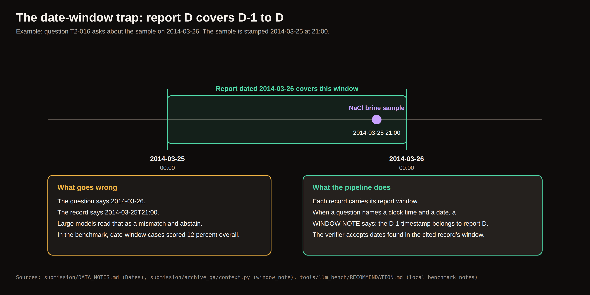
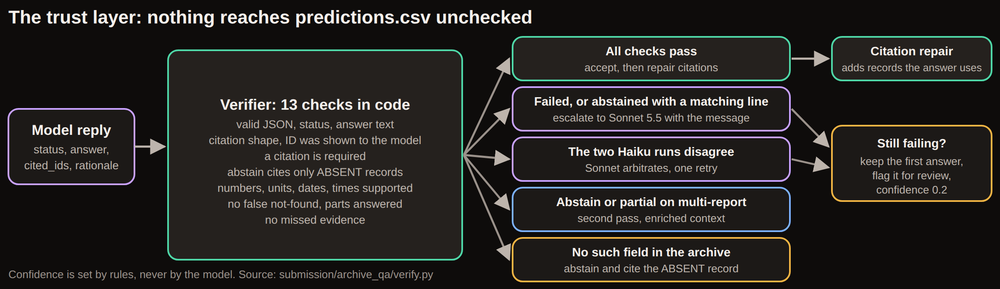
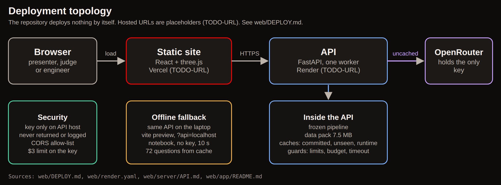

# Architecture: Intelligent Well Archive

Team Trinergy, NAPE AICE 2026, Track 2. For reviewers: see [REVIEWER_GUIDE.md](REVIEWER_GUIDE.md) to run it. The diagrams are in [img/](img/).

## 1. The idea in four rules

1. **Code finds the facts.** A parser, a router and a context builder choose the evidence. The model never searches the archive.
2. **The AI only phrases.** A small model (Haiku 5.5) turns a handful of evidence lines into a short answer in a fixed JSON shape.
3. **A verifier checks.** Thirteen checks in code. A number, date or ID that is not in the cited records is rejected.
4. **Abstaining is a valid answer.** If the archive has no such field or report, the answer says what was searched.

## 2. End to end

| Stage | Module (`submission/archive_qa/`) | In | Out | What it prevents |
|---|---|---|---|---|
| Discover | `wells.py`, `config.py` | XML and PDF folders | list of 32 reports by wellbore and date | wrong well counts; one place for the data path |
| Parse | `parse.py` | WITSML 1.4 XML | records with value, unit, time stamp, report window | guessing from paragraphs; lost repeated tags |
| Locate | `locate.py` | records, PDF text | page, section, highlight box per record | citing a page that does not show the value |
| Store | `store.py`, `discrepancy.py`, `xmlonly.py` | records | the evidence store (1,783 records) with stable IDs, derived NOTE records, XML-only flags | losing the XML-PDF conflicts |
| Route | `route.py` | question text | wells, dates, topics, mode, candidate reports, or an early abstain | wrong well or day; sending the whole archive when one report is enough |
| Context | `context.py`, `enrich.py`, `match.py` | routed reports, question | evidence lines, window notes, aggregates, ABSENT and NOTE records | reading a D-1 stamp as a date mismatch; counting by hand |
| Model | `prompts.py`, `llm.py`, `answer.py` | context, question | JSON: status, answer, cited IDs, rationale | free-form answers that cannot be checked |
| Verify | `verify.py`, `repair.py` | reply, context | pass or a failure message; repaired citations | wrong numbers; unseen IDs; false "not found" |
| Write | `write.py`, `pipeline.py` | answers, store | `predictions.csv` with evidence built from the store | invented citations |

## 3. Evidence records and the citation flow

Every fact has one ID. The same ID appears in the context line the model sees, in the model's citation, and in the evidence column. The writer builds the evidence string from the store, not from model text, so an unknown ID can never be printed. Values the PDF never prints are cited as XML only.

## 4. The date-window trap

A report dated D covers D-1 00:00 to D 00:00. A sample stamped 2014-03-25 at 21:00 is in the report dated 2014-03-26. Every record carries its window; when a question names a clock time and a date, a WINDOW NOTE says the earlier stamp belongs to the report; and the verifier accepts dates found in the cited record's window. In the model benchmark, date-window cases were the most common failure, and larger models abstained on them more than the small one.

## 5. The trust layer

- **Escalate:** the verifier failed, or the model abstained although a matching line exists. One Sonnet 5.5 call that sees the verifier's message. A plain "no such field" abstention is not escalated.
- **Arbitrate:** two independent Haiku runs disagree on status or key numbers. Sonnet decides; if its answer fails the checks it gets one retry; otherwise run 1 is kept and flagged.
- **Second pass:** multi-report or archive-wide questions only, once. The first pass abstained, was partial, or tripped the abstain flag. The retry gets computed aggregates, a field catalogue and the full records of the named wells.
- **Citation repair:** adds records whose content the answer clearly uses, then checks the answer still verifies.
- **Confidence** is computed by rules, never by the model (`verify.py`, `confidence`).

## 6. Computed aggregates

For multi-report and archive-wide questions that ask for a count, an extreme or a comparison, `enrich.py` finds fields whose names match the question's words (camelCase parts plus a small vocabulary of standard abbreviations, such as `md` for measured depth) and computes count, minimum, maximum and the source records. These appear as evidence lines with IDs such as `AGG-00000000-WATERDEPTH` and `IDX-00000000-WELLBORES`. If the model cites one, the evidence column cites its source records instead. The 32 published contexts are unchanged by this (a test asserts it).

## 7. Reproducibility and the answer cache

`llm.py` stores each model answer under a sha256 key of the system prompt, context, question text, feedback, model, settings, prompt hash and run label. The committed `indexes/llm_cache.json` holds 130 entries and records the models and settings, so an offline replay rebuilds the same keys. A layered cache reads the committed file first and writes new answers only to a git-ignored runtime cache. With no key and no cached answer, a row reads `NOT EVALUATED: no API key and no cached answer`.

## 8. Backend API and trace

The optional backend (`web/server/`, FastAPI) wraps the frozen pipeline without editing it. A trace builder observes the pipeline from outside with pass-through wrappers and a proxy around the model client. It never changes arguments or return values. Tests prove that predictions and caches are byte-identical after live questions.

Main endpoints: `GET /health`, `GET /questions`, `GET /questions/{id}`, `POST /ask`, `POST /ask/stream` (server-sent events, one per real stage), `GET /pages/{record}.png` (the PDF page with evidence highlighted), `GET /archive`, `GET /trajectories`, `GET /costs`, `GET /generalisation`. Full detail: [../../web/server/API.md](../../web/server/API.md).

**Trace schema** (every answer): `router` (mode, confidence level, reports and why), `contexts` (tokens, records, aggregates, ABSENT), `model_calls` (role, model, cache hit, provider-reported tokens, latency, cost), `verifier` (the 13 named checks), `escalations`, `second_pass`, `arbitration`, `cited`, `decisions`, `warnings`, `totals`, `events`.

**Guardrails:** a clarification gate (a vague question with no well, date or field term and no cached answer gets examples and costs nothing); a 400-character question cap; rate limits (6 per minute and 40 per day per client); 4 concurrent questions; a 120-second timeout; a persisted spend cap (default $2.00); a CORS allow-list; security headers on every response; key redaction in every log and error.

**Data pack.** The server runs from `web/server/data/` (7.5 MB: records, 54 page images, highlight boxes, the unseen-set answers). No organiser raw file is needed at run time.

## 9. Dashboard

A React and TypeScript app (`web/app/`, built with Vite, 3D with three.js) over the real API. Views: Overview, Mission control (2D replay of the real trace, 3D with a Focus mode), Questions (all 72), Answer (evidence page with highlight boxes, trace timeline), Generalisation, Impact, Archive, Cost, Ask, Presenter mode, Styleguide. Fonts, icons and libraries are bundled; the only run-time calls go to the API. Design tokens follow the Heirs palette in `web/app/src/styles/tokens.css`.

## 10. Deployment

The plan is the API on Render and the static site on Vercel (no hosted address yet). The repository deploys nothing by itself; see [../../web/DEPLOY.md](../../web/DEPLOY.md) and [../../web/render.yaml](../../web/render.yaml). The OpenRouter key lives only on the API host, is never returned or logged, and should carry its own credit limit. Offline fallback: the same API and the built dashboard run on a laptop, and the notebook needs no key.

## 11. Design trade-offs

| Choice | Why | Cost |
|---|---|---|
| Small model as primary | Best accuracy on our benchmark cases at a twentieth of Sonnet's price; the verifier does the checking | Needs the verifier and escalation |
| Two Haiku runs | Cheap disagreement detector | Doubles the small-model calls (8 cents of 65 for all 32 questions) |
| Cache committed to the repository | Reviewers rerun with no key and get the same file | Cache keys change if the prompt changes |
| XML as source of truth, PDF for pages | The XML is complete and consistent; the PDF is what a person can open | 21 percent of records have no PDF page |
| Aggregates computed in code | Models count and compare poorly across many reports | A field-name match can miss unusual wording |

## 12. Limits

One field and 32 reports; no scanned pages or OCR; no cost, personnel, supervisor or weather fields in the archive; the 40-question unseen result was tuned on those questions; the engineer's hand check and an independent test are pending. See [REVIEWER_GUIDE.md](REVIEWER_GUIDE.md), section 13.
